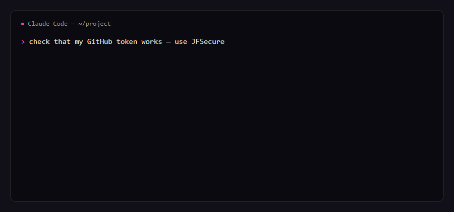

# jfs — secrets for AI agents that never see them

`jfs` is the command line and **MCP server** of [JFSecure](https://secure.jfolio.org/), an offline password and
snippet manager. It lets Claude Code, Cursor or any MCP agent **use** a secret without ever **getting** it — and you
approve every use in the app.

This repository is the source of `jfs` itself, so you can read exactly what an agent talks to. It is a thin client:
it sends one JSON request over a local pipe to the **running, unlocked JFSecure app** and prints the answer. It never
opens vault files, never sees the vault password and has no crypto. (The app is a separate download; `jfs` ships with it.)



## MCP tools

| Tool | What it does | What the agent gets back |
|---|---|---|
| `list_secrets` | Lists secret and key names, with the environment variable each key becomes | Names only |
| `run_with_secrets` | Runs a command with a secret's keys as environment variables (all, some, or one on stdin) | Exit code and output, every value masked as `[JFSecure: NAME]` |
| `render_template` | Fills `{{Secret:key}}` in a template and writes the file (e.g. `.env`) | Which names were filled in |

There is no "get" tool, on purpose. Every use opens an approval window in JFSecure that shows the program, the
**exact command** and the secret: allow once, allow 15 minutes, or deny. For Claude Code a 15-minute approval covers
only that command and that secret.

```
# the agent called run_with_secrets(secret: "github", command: …)
exit code 0
variables set: TOKEN
--- stdout ---
token is [JFSecure: TOKEN]
{"login": "octocat", "plan": {"name": "pro"}}
```

## Set up

1. Install JFSecure and open your vault: `brew install theone55/jfsecure/jfsecure` (macOS),
   `scoop bucket add jfsecure https://github.com/theone55/scoop-jfsecure; scoop install jfsecure/jfsecure` (Windows),
   or [the installer](https://secure.jfolio.org/download) (Windows, macOS, Linux). `jfs` comes with it: on Windows the
   app puts it on PATH at its first start (open a new terminal afterwards); on macOS (.dmg) and the Linux AppImage use
   Settings → *Install the jfs command*; Homebrew and the .deb install it for you.
2. Add the MCP server:

```sh
claude mcp add --scope user jfsecure -- jfs mcp
```

Cursor (`~/.cursor/mcp.json`), Claude Desktop, Windsurf, VS Code — any stdio MCP client:

```json
{ "mcpServers": { "jfsecure": { "command": "jfs", "args": ["mcp"] } } }
```

More: https://secure.jfolio.org/agents

Also as an MCP bundle (`.mcpb`, Windows / macOS / Linux) on the [releases](https://github.com/theone55/jfs/releases) page, and in the official MCP Registry as `io.github.theone55/jfs`.

## Command line

```
jfs status                       is the app running and unlocked
jfs ls [secret|folder]           names only, no approval needed
jfs get github/token             print a value (approved in the app)
jfs copy github/token            to the clipboard, nothing printed
jfs run github -- gh api user    run with the secret's keys as env vars ($token → TOKEN); output masked when piped
jfs render .env.tpl -o .env      fill {{Secret:key}} into a file
git config --global credential.helper "!jfs git-credential"
```

Full guide: https://secure.jfolio.org/cli

## What it protects — and what it doesn't

- The model never receives a value, so it can't end up in a transcript or a log.
- A prompt-injected agent can only ask; you see the exact command.
- The pipe is your OS user's only, and the app identifies the caller through the OS, not by what it says.
- **Masking is a seatbelt, not a wall:** a command you approve can still send a value away. Read the command.

## Build

```sh
cargo build --release   # Rust stable; Windows, macOS, Linux
cargo test
```

The copy here follows each JFSecure release (`version` in Cargo.toml = the app's version it shipped with).
Issues and questions are welcome here.

MIT License.
